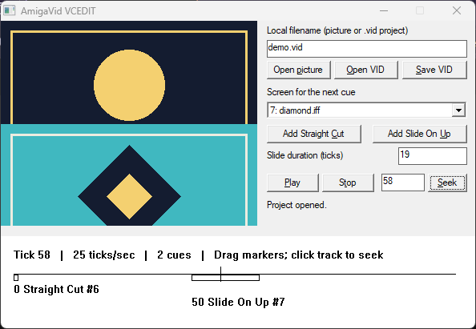

# AmigaVid

AmigaVid aims to bring Almathera's Amiga CD32 Video Creator to Windows 98 and
XP as a native, offline, 32-bit x86 Win32 port. No Amiga emulator or ROM is
required at runtime.

See [Video-Creator-Win32-PRD.md](Video-Creator-Win32-PRD.md) for detailed
requirements and acceptance evidence.

## Have a Video Creator disk or backup?

We're still looking for five original files: `DT_STUFF.S`,
`vc:vectors/Macros.i`, `dancer2.vec`, `dancer5.vec` and `dancer7.vec`.
Standalone originals of `vc:vectors/TEST` and `SineTable.bin` are also
welcome for provenance; their compiled payloads have been recovered.
The European retail disc has supplied projects, fonts and most vector
filenames; see the
[current recovered and missing inventory](PROGRESS.md#recovered-and-missing-files).

Found a file or a lead? [Open an issue](https://github.com/kninetimmy/amigavid/issues/new).
**No upload is needed:** tell us the original path, source or edition,
size and SHA-256 if available. Attach a file to the public issue only if
you are authorized to share it publicly.

## What works today

The starting point was the archived Amiga source, not a Windows app.
After inventorying it, proving the Windows toolchain and opening real
artwork, milestone 3 delivered `VCEDIT.EXE`: a small native editor that
loads two pictures, places a Straight Cut and a timed Slide On Up, and
saves, reopens and replays the sequence.

Milestone 4 adds **Slide On Down**, **Slide Off Up** and **Slide Off Down**
(VC10 IDs 3–5), followed by **Scroll Up**, **Scroll Down**, **Reveal Up**
and **Reveal Down** (IDs 6–9).
These additions have Windows 11 host checks, not guest qualification.

**The first useful workflow has been demonstrated in QEMU:** on Windows
98 SE, add the pictures and effects, drag the transition's start time,
save a `.vid` project, quit, reopen and replay. Then transfer that exact
save and its pictures to x86 Windows XP Professional SP3 and replay it
with the same executable. All 11 sampled frames matched the expected
output, accounting for the measured 98 display-color conversion.
See the [milestone 3 evidence](PROGRESS.md#guest-verification).

That guest-tested build predates the later timeline selection and drag
fixes and the additional effects, which have been checked on Windows 11 only.
The screenshot below shows the timeline-fixed editor before the additional
effect controls, on that development host, not a 98 or XP run.
Physical Windows 98/XP hardware, original Amiga-reader compatibility and
full editor-release qualification remain unverified.



*Windows 11 x64: the running editor paused with Seek at tick 58, partway
through Slide On Up. The two geometric test cards were created independently
for this README and are publication-cleared; no archive artwork is shown.*
[Capture provenance](PROGRESS.md#readme-illustration--issue-25).

**Continuing milestone 4** — add the remaining effects, animated 2D/3D vectors,
QuadAnims, text and palette effects in small, tested batches. CD audio and
the remaining editing workflows follow in milestone 5; this is not yet
the complete Video Creator port.

## Expected phases

0. **Establish the baseline:** verify the pinned archive and inventory source
   files and assets.
1. **Prove the Windows toolchain:** show a native probe opening a window and
   exercising input.
2. **Open a real asset:** decode and display actual editor artwork.
3. **Edit, save and replay one sequence:** save, reopen and replay a
   two-image sequence with a timed transition.
4. **Port all effects and special screens:** port vectors, QuadAnims, text and
   palette effects.
5. **Complete media, editor and persistence:** finish CD audio, cue marking
   and Random Raves.
6. **Qualify and package:** qualify the same portable ZIP on both Windows
   families.

## Probe and viewer status

The Open Watcom Win32 probe has a repeatable build and a Windows 11 host
smoke test. The unchanged kit also passes on all four QEMU guest targets:
Windows 98 FE (4.10.1998), 98 SE (4.10.2222), x86 XP RTM
(2600.xpclient.010817-1148), and x86 XP Professional SP3
(2600.xpsp.080413-2111). Physical-hardware and editor-release validation
remain open. The ILBM viewer also passes its fixture tests,
Windows 11 smoke test and four-guest display, hide/restore and failed-open
recovery checks with the same executable. XP RTM/SP3 match the exact
canonical RGB24 frames; 98 FE/SE match every pixel after the independently
measured Cirrus display-channel conversion. That conversion merges two
background grays into one displayed color (16 displayed colors from 17
canonical colors), as allowed by issue #16; no tolerance is used. See the
[probe matrix](PROGRESS.md#runtime-evidence) and
[viewer evidence](PROGRESS.md#milestone-2--real-asset-ilbm-viewer).
These four-guest results are for the probe and viewer, not the editor.

## Build and test the Win32 probe

From a clean checkout on modern x64 Windows with Python 3.13 or later, run
these commands in order from the repository root:

```powershell
python tools/probe.py bootstrap
python tools/probe.py build
python tools/probe.py inspect
python tools/probe.py package
python tools/probe.py smoke
```

Only `bootstrap` needs the network on a clean checkout. It downloads the
[dated Open Watcom v2 C release](https://github.com/open-watcom/open-watcom-v2/releases/tag/2026-11-01-Build)
Windows x64 host asset (ID `697737741`, 128,145,854 bytes) and checks its
official SHA-256, `d4e496c593ef2acbc54d1eaeb31b31d9c62f86e39a09e61ada411ef34feaa01a`.
A mismatched download or cached file is rejected. The build rechecks the
cache before extracting tools to a temporary checkout-local folder. It
does not run the installer, make a global installation or change your
environment. No original archive or assets are needed.

The host compiles with `wcc386 -bt=nt -bg -3r` and links with `wlink` using
`system nt_win`, the ANSI `WinMain` startup and GUI subsystem version 4.0.
The build normalizes the unsigned executable's COFF timestamp, and ZIP
entries have fixed timestamps. `.probe/build/PE-IMPORTS.txt` lists the PE
headers, imports and build provenance; `probe.map` and `probe.lst` in that
same folder show the linker inputs and application-object disassembly.

On an interactive, unlocked host desktop, `smoke` runs the extracted
32-bit executable from a directory with spaces with a different working
directory. It samples the painted DIB, posts mouse and keyboard window
messages, checks the actual WinMM count and simulated no-audio status,
and checks clean exits and missing/malformed-file dialogs. See
`.probe/HOST-SMOKE.txt` for the observed results. The recorded Windows 11
run reported actual `waveOut=3`; its `/noaudio` check was simulated, not a
true zero-output-device test.

Verify `.probe/VCPROBE.ZIP` against `.probe/VCPROBE.ZIP.sha256` on the
modern host. On each target, follow the included [TEST.TXT](probe/TEST.TXT):
extract to a folder with spaces, then launch offline from Explorer or a
Windows `COMMAND.COM` session. The kit includes no target-side developer
tools and requires no separately installed CRT. This is a local test kit,
not the editor or a release. See [PROGRESS.md](PROGRESS.md) for results.

## Archive inventory

The pinned source archive is a local reference input, not repository content.
Download [`vc.zip`](https://archive.org/download/vc_20221206/vc.zip) from the
pinned source in the PRD, place it at the ignored path `inputs/vc.zip`, then
run:

```text
python tools/inventory.py
```

The standard-library-only command verifies SHA-256
`ef4622f337e4e6331fdc97d5da6ec54d35f0d39bcd28ab898ce3689b8fb36ee3` before it
reads ZIP metadata. It never extracts or executes archive members, and its
source and asset listing is deterministic. A missing archive or checksum
mismatch exits nonzero with a diagnostic on stderr and produces no inventory.
The script also accepts a local ZIP path as its only argument when the archive
cannot be placed under `inputs/`.

See [the historical milestone 0 archive baseline](docs/BASELINE.md) for the
source-ZIP input map, retained reference material, attribution and pre-probe
target-status matrix. Its gaps and pending rows are historical; use the
[current inventory](PROGRESS.md#recovered-and-missing-files) for retail-disc
recovery and remaining file and verification gaps, and the
[live progress matrix](PROGRESS.md#runtime-evidence) for platform status.

## Build and test the ILBM viewer

On modern x64 Windows with Python 3.13+, run from the repository root. Put
the pinned ZIP described above at `inputs/vc.zip`. For `test`, have a host
GCC or Clang on `PATH` (`CC` can name the compiler executable). For `smoke`,
use an NTFS checkout and an unlocked desktop at 100% scale. Leave the
viewer visible and unobscured.

```powershell
python tools/probe.py bootstrap
python tools/asset.py prepare
python tools/asset.py build
python tools/asset.py test
python tools/asset.py smoke
```

`prepare` optionally takes a local ZIP path. It verifies the pinned ZIP
and copies only `vc/data/blankeditor.iff` and
`vc/vcpics/jolyons/artimages/blueface.16` to `inputs/Viewer Assets/`.
`tools/inventory.py` still only lists metadata; `prepare` is the separate
command that extracts the two files. `build` needs the same verified
Watcom cache as the probe but no artwork. `test` feeds the two fixtures and
small generated cases to the portable C decoder linked into the GUI; it
checks exact top-down RGB24 size and digests. `smoke` logs actual window
pixels, repaint, dialogs, recovery and path-rejection results to
`.asset/HOST-SMOKE.txt`, and writes two native-window BMPs to `.asset/`.
Keep the original assets, BMPs and executables local; do not commit or
publish them.

Run the viewer manually from any working directory with an explicit asset
root. For example, from the checkout:

```powershell
$root = (Resolve-Path '.\inputs\Viewer Assets').Path
& (Resolve-Path '.\.asset\VCASSET.EXE').Path $root
```

The background opens first. Use **File → Background** and **File →
Picture** to switch or retry after an error. The viewer paints at 1:1 at
the upper left of the client area; it is not the editor. Both menu choices
use an indexed DIB and realize the image palette on paint and palette
activation/change, rather than mapping true-color pixels to the default
system palette on 256-color displays. Their fixed leaf names are resolved
only under the selected absolute local drive folder, never under the
working directory.
This restriction applies to both names, not just `blueface.16`. Relative,
parent-traversing, UNC and device paths are not accepted. On NT the viewer
still rejects reparse points (including junctions), multiply-linked files
and non-regular files. Previously it checked each directory but used
absolute paths for later opens. Now it opens the directly mapped local
volume's root once per read and opens each subsequent name relative to
its checked parent handle. It refuses directory aliases (such as `SUBST`)
and does not fall back to absolute paths if safe resolution fails.
On 9x it still requires a local FAT/FAT32 drive and opens by absolute
path. Use ANSI-representable paths within `MAX_PATH`. The decoder handles
indexed 1–8 plane ILBM with raw or ByteRun1 rows (up to 1024×1024 and
4 MiB input); HAM, Extra Half-Brite, masks and other formats are not
supported here.

## Build and use the two-picture editor

On a modern x64 Windows host, use the same Python, Watcom bootstrap, host C
compiler and desktop setup as the viewer. Use an NTFS checkout on a directly
mapped local drive for the native `test` and `smoke` cases. `build` and `test`
do not need the archive; `smoke` uses the two locally prepared fixtures:

```powershell
python tools/probe.py bootstrap
python tools/asset.py prepare
python tools/editor.py build
python tools/editor.py test
python tools/editor.py smoke
```

For a fast, deterministic check of timed Play retry diagnostics, run separately:

```powershell
python -m unittest discover -s tools -p test_play_capture.py
```

These three tests use controlled stop ticks and frames; no archive, compiler,
built executable or interactive desktop is needed. They check retry attempt
order, immediate frame-mismatch failure and successful retry logging. They do
not replace native `smoke`, measure playback timing or qualify Windows 98/XP.

Launch `.editor\VCEDIT.EXE` with a single absolute, local workspace directory:

```powershell
& .\.editor\VCEDIT.EXE (Resolve-Path '.\inputs\Viewer Assets').Path
```

On a guest, for example: `C:\M3EDIT\VCEDIT.EXE C:\M3EDIT`. Copy your two
pictures to that folder first. It must be on local FAT on Windows 98.

1. Enter the first picture's filename, then **Open picture** (Ctrl+I).
   Choose **Add Straight Cut**. Open the second picture and choose
   **Add Slide On Up**, **Add Slide On Down**, **Add Slide Off Up** or
   **Add Slide Off Down**, or choose **Add Scroll Up**, **Add Scroll Down**,
   **Add Reveal Up** or **Add Reveal Down**. The screen list selects the target
   for the next cue; **Ticks** sets the transition duration parameter
   (1–255, default 25), in 25ths of a second.
2. Drag the second cue's marker horizontally to a new start tick. Cues
   are kept in time order; a drop that would overlap is refused. **Play**
   (F5) starts from tick 0, **Stop** (Esc) holds the frame, and **Seek**
   renders the exact tick in the edit box without waiting on the timer.
3. Enter a new `.vid` filename, then **Save VID** (Ctrl+S). Quit and
   relaunch, enter the same filename, **Open VID** (Ctrl+O), then **Play**.
   Move the file together with its pictures to play on another PC.

Press anywhere inside a drawn marker to target its start. If marker bodies
overlap at the pointer, the last-drawn one wins. If the pointer is not inside
any body, the first marker in timeline order whose start is within five
horizontal pixels wins. Clicking empty track clears selection and seeks.

When multiple cues start at the winning pixel, successive stationary clicks
select them in timeline order and wrap to the first. The tick box and status
identify the selected cue's start tick, replacing any unsubmitted tick text.
Selection alone does not change saved cue data. Drag to move the selected cue
at that pixel, or the first cue if none is selected there. The drag keeps the
horizontal grab offset; a short drag that leaves the cue in place still
selects it. Opening another project cancels any pending drag and clears
selection.

Use a workspace you control; don't edit its files in another program during
a save. Project filenames are ASCII leaves ending in `.vid`; new picture
filenames are ASCII leaves of at most 24 characters (spaces inside are OK).
Imported VC10 asset names are workspace-relative or use `VCPics:` and can
name subfolders using `/`. Windows drive letters, UNC, path traversal and
device names are rejected, and NT reads refuse junctions, symlinks and
multiply-linked files. These rules apply to **every** picture reference,
including both members of a pair, and link checks apply to project reads
too. A `~` in a filename (including an 8.3 alias) or supported effect text
round-trips using the original shifted bytes. Pictures use the viewer's
indexed ILBM decoder with an editor canvas limit of 320×256. On indexed
displays a frame is palette-realized when its colors fit a single logical
palette; exactness on 8-bit hardware depends on the available entries.

Slide On moves the incoming picture over the outgoing one; Slide Off moves
the outgoing picture away to reveal the target. Scroll moves both pictures
in the chosen direction; Reveal moves the boundary over stationary pictures.
Source integer rounding can settle a transition before its timeline marker
ends. The original one-tick **Slide Off Down**, **Scroll Down** and **Reveal
Down** skip their screen swap and leave the outgoing picture (black for a
first cue); the port preserves that quirk. Seek and Play use the same logical
two-field-per-tick picture rows, not Amiga copper buffering or display tricks.

The editor preserves active VC10 screen order, paired references, author,
track number, and all nine supported effects' IDs, timing, parameters and text.
It previews the first member of a pair only; Psycho Flicker and CD audio are not
implemented. Other effect IDs, special screen IDs, object tables and
malformed files are refused without replacing the open document. To replace a
file, first open that file in the editor. A replacement stages and flushes
the new bytes before moving the previous file to `name.vid.bak`. If publish
fails, the editor tries to restore the previous file. An existing backup
blocks a retry; if the `.vid` is missing after interruption or a failed
rollback, inspect the `.bak` and rename a copy to `.vid` to recover it.
If publish succeeds but backup cleanup fails,
the editor reports a saved project with a retained `.bak`, not unsaved edits.
Initially, the NT editor pinned the workspace only for reads and used the
launch path again for saves. Now **all** NT save paths (destination/backup
checks, staging, renames, rollback and cleanup) stay relative to the pinned
directory or use checked file handles, even if the drive spelling changes.
Previously an NT replacement wrote to a file with inherited permissions
without checking the original project's permissions. Now it writes no
project bytes unless the original and empty stage have matching access
metadata. If the check fails or the project uses file encryption, save
under a new name in a suitably protected workspace.
Previously a typed 8.3 alias could become the project's name after
replacement or rollback. Both save paths now refuse replacement through
a true short alias; reopen by the full filename. A literal `~` filename
is still valid. This applies to every replacement, not to reads.
Previously NT replacement could lose a project's named data streams when
it discarded the old file. Now every NT replacement checks the opened
original and refuses before staging if it finds extra streams or cannot
confirm that only the ordinary data stream exists. The original is left
untouched; save to a new filename to keep it. Reads, first saves, and
replacement of eligible ordinary files are unchanged.
The Windows 98 local FAT/FAT32 fallback still uses absolute paths; this is
not a power-loss guarantee for FAT.

## Release acceptance

The two-picture demo above is an intermediate milestone. For release
acceptance, the same portable ZIP must pass the edit,
save, reopen and playback workflow on both Windows families. A modern-host
smoke test does not qualify either target, and guest probe passes are not
editor-release or physical-hardware validation.
